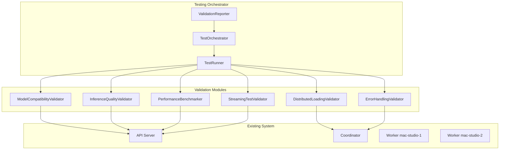

# Design Document - Large Model Variant Testing

## Overview

This design outlines a comprehensive testing framework for validating large model variants like qwen3-coder-480b-mlx on the distributed inference system. The design leverages existing infrastructure while adding model-specific validation, performance benchmarking, and quality assurance components.

## Architecture

### Testing Framework Components



### Model Path Configuration

The system will use the provided model paths:
- **mac-studio-1**: `/Volumes/thunderbay/models/qwen3-coder-480b-mlx`
- **mac-studio-2**: `/Volumes/models/mlx/qwen3-coder-480b-mlx`

## Components and Interfaces

### 1. TestOrchestrator

**Purpose**: Coordinates the entire testing workflow for model variants.

**Key Methods**:
```python
class TestOrchestrator:
    def run_full_validation(self, model_path: str, model_name: str) -> ValidationReport
    def run_compatibility_check(self, model_path: str) -> CompatibilityResult
    def run_performance_benchmark(self, model_name: str) -> BenchmarkResult
    def generate_validation_report(self, results: List[TestResult]) -> ValidationReport
```

**Responsibilities**:
- Orchestrate test execution sequence
- Coordinate between validation modules
- Aggregate results and generate reports
- Handle test failures and cleanup

### 2. ModelCompatibilityValidator

**Purpose**: Validates model format, configuration, and MLX compatibility.

**Key Methods**:
```python
class ModelCompatibilityValidator:
    def validate_mlx_format(self, model_path: str) -> bool
    def check_model_config(self, model_path: str) -> ModelConfig
    def validate_tokenizer(self, model_path: str) -> bool
    def estimate_model_size(self, model_path: str) -> float
    def check_sharding_eligibility(self, model_size: float) -> bool
```

**Validation Checks**:
- MLX format compatibility (safetensors, config.json)
- Model configuration parameters
- Tokenizer functionality
- Size estimation for sharding decisions
- Hardware compatibility (Apple Silicon)

### 3. DistributedLoadingValidator

**Purpose**: Tests model loading and partitioning across workers.

**Key Methods**:
```python
class DistributedLoadingValidator:
    def test_model_download(self, model_name: str, enable_sharding: bool) -> LoadResult
    def validate_layer_partitioning(self, model_name: str) -> PartitionResult
    def check_memory_usage(self, workers: List[str]) -> MemoryReport
    def verify_model_availability(self, model_name: str) -> bool
```

**Testing Scenarios**:
- Automatic sharding with 2 workers
- Layer distribution validation
- Memory usage per worker
- Load failure recovery
- Partial cleanup on errors

### 4. InferenceQualityValidator

**Purpose**: Validates inference accuracy and consistency.

**Key Methods**:
```python
class InferenceQualityValidator:
    def test_deterministic_output(self, model_name: str, prompt: str) -> ConsistencyResult
    def compare_distributed_vs_single(self, model_name: str) -> ComparisonResult
    def test_prompt_variations(self, model_name: str) -> QualityResult
    def validate_sampling_parameters(self, model_name: str) -> SamplingResult
```

**Test Cases**:
- Deterministic output with fixed seeds
- Comparison with single-node inference (if possible)
- Various prompt types (code, text, questions)
- Different sampling parameters
- Edge cases (empty prompts, very long prompts)

### 5. PerformanceBenchmarker

**Purpose**: Measures performance characteristics and identifies bottlenecks.

**Key Methods**:
```python
class PerformanceBenchmarker:
    def measure_latency_metrics(self, model_name: str) -> LatencyMetrics
    def test_throughput_scaling(self, model_name: str) -> ThroughputResult
    def measure_distributed_overhead(self, model_name: str) -> OverheadAnalysis
    def profile_memory_usage(self, model_name: str) -> MemoryProfile
```

**Benchmarks**:
- Time-to-first-token (TTFT)
- Tokens-per-second (TPS)
- Concurrent request handling
- Memory usage patterns
- Network transfer overhead
- Cache hit rates

### 6. StreamingTestValidator

**Purpose**: Tests streaming inference functionality.

**Key Methods**:
```python
class StreamingTestValidator:
    def test_streaming_latency(self, model_name: str) -> StreamingResult
    def validate_token_ordering(self, model_name: str) -> OrderingResult
    def test_long_generation(self, model_name: str) -> GenerationResult
    def test_backpressure_handling(self, model_name: str) -> BackpressureResult
```

**Streaming Tests**:
- Real-time token streaming
- Token ordering across workers
- Long generation stability
- Backpressure scenarios
- Connection handling

### 7. ErrorHandlingValidator

**Purpose**: Tests error scenarios and recovery mechanisms.

**Key Methods**:
```python
class ErrorHandlingValidator:
    def test_worker_failure_scenarios(self, model_name: str) -> FailureResult
    def test_network_interruption(self, model_name: str) -> NetworkResult
    def test_memory_pressure(self, model_name: str) -> MemoryResult
    def test_recovery_mechanisms(self, model_name: str) -> RecoveryResult
```

**Error Scenarios**:
- Worker disconnection during inference
- Network timeouts
- Memory exhaustion
- Activation transfer failures
- Graceful degradation

## Data Models

### ValidationReport
```python
@dataclass
class ValidationReport:
    model_name: str
    model_path: str
    test_timestamp: datetime
    compatibility_result: CompatibilityResult
    loading_result: LoadResult
    quality_result: QualityResult
    performance_result: BenchmarkResult
    streaming_result: StreamingResult
    error_handling_result: FailureResult
    overall_status: TestStatus
    recommendations: List[str]
    issues_found: List[Issue]
```

### BenchmarkResult
```python
@dataclass
class BenchmarkResult:
    ttft_ms: float
    tps: float
    concurrent_throughput: float
    memory_usage_per_worker: Dict[str, float]
    distributed_overhead_percent: float
    cache_hit_rate: float
    bottlenecks_identified: List[str]
```

### TestConfiguration
```python
@dataclass
class TestConfiguration:
    model_paths: Dict[str, str]  # worker_id -> model_path
    test_prompts: List[str]
    benchmark_duration_seconds: int
    concurrent_request_count: int
    streaming_test_length: int
    error_injection_scenarios: List[str]
```

## Error Handling

### Test Failure Recovery
- **Partial Test Failures**: Continue with remaining tests, mark failed components
- **Model Loading Failures**: Clean up partial loads, provide diagnostic information
- **Infrastructure Failures**: Retry with exponential backoff, fallback to subset testing
- **Timeout Handling**: Configurable timeouts per test phase with graceful termination

### Error Classification
- **Critical**: Model incompatibility, loading failures
- **Warning**: Performance below thresholds, minor inconsistencies
- **Info**: Configuration recommendations, optimization suggestions

## Testing Strategy

### Test Execution Phases

1. **Pre-flight Checks**
   - Verify model paths exist on both workers
   - Check system resources and availability
   - Validate test configuration

2. **Compatibility Validation**
   - Model format verification
   - Configuration parsing
   - Tokenizer testing

3. **Loading and Partitioning**
   - Distributed model loading
   - Layer assignment verification
   - Memory usage validation

4. **Inference Quality Testing**
   - Deterministic output verification
   - Quality assessment across prompt types
   - Parameter sensitivity testing

5. **Performance Benchmarking**
   - Latency measurements
   - Throughput testing
   - Resource utilization profiling

6. **Streaming and Generation**
   - Real-time streaming validation
   - Long generation testing
   - Flow control verification

7. **Error Scenario Testing**
   - Failure injection and recovery
   - Graceful degradation validation
   - System stability under stress

8. **Report Generation**
   - Results aggregation
   - Issue identification
   - Recommendation generation

### Test Data and Prompts

**Code Generation Prompts** (for qwen3-coder):
```python
TEST_PROMPTS = [
    "Write a Python function to calculate fibonacci numbers",
    "Create a REST API endpoint using FastAPI",
    "Implement a binary search algorithm in Python",
    "Write a class for managing database connections",
    "Create a function to parse JSON configuration files"
]
```

**Performance Test Scenarios**:
- Single request latency
- 5 concurrent requests
- 10 concurrent requests
- Long generation (1000+ tokens)
- Streaming with backpressure

### Success Criteria

**Performance Thresholds**:
- TTFT < 2000ms for first token
- TPS > 10 tokens/second sustained
- Distributed overhead < 30%
- Memory usage < 80% per worker
- 99% uptime during testing

**Quality Thresholds**:
- 100% deterministic output consistency
- 0% token ordering errors in streaming
- < 1% inference failures under normal load
- Complete error recovery within 30 seconds

## Monitoring Integration

### Metrics Collection
- Extend existing Prometheus metrics with test-specific labels
- Add model variant identification to all metrics
- Track test execution progress and results
- Monitor resource usage during testing

### Alerting
- Test failure notifications
- Performance threshold violations
- Resource exhaustion warnings
- Quality degradation alerts

### Dashboards
- Real-time test execution status
- Performance comparison charts
- Error rate tracking
- Resource utilization trends

## Implementation Notes

### Existing Infrastructure Reuse
- Leverage existing gRPC interfaces for worker communication
- Use current metrics collection for performance data
- Extend existing logging for test result tracking
- Reuse model loading and inference pipelines

### Configuration Management
- Add test configuration to existing YAML structure
- Support environment variable overrides for test parameters
- Maintain backward compatibility with existing configurations

### Integration Points
- API endpoints for test execution and status
- Coordinator integration for distributed test coordination
- Worker integration for local validation and metrics
- Monitoring system integration for observability