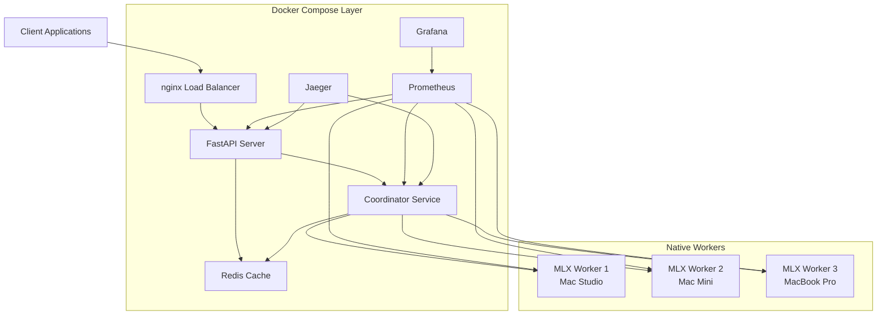
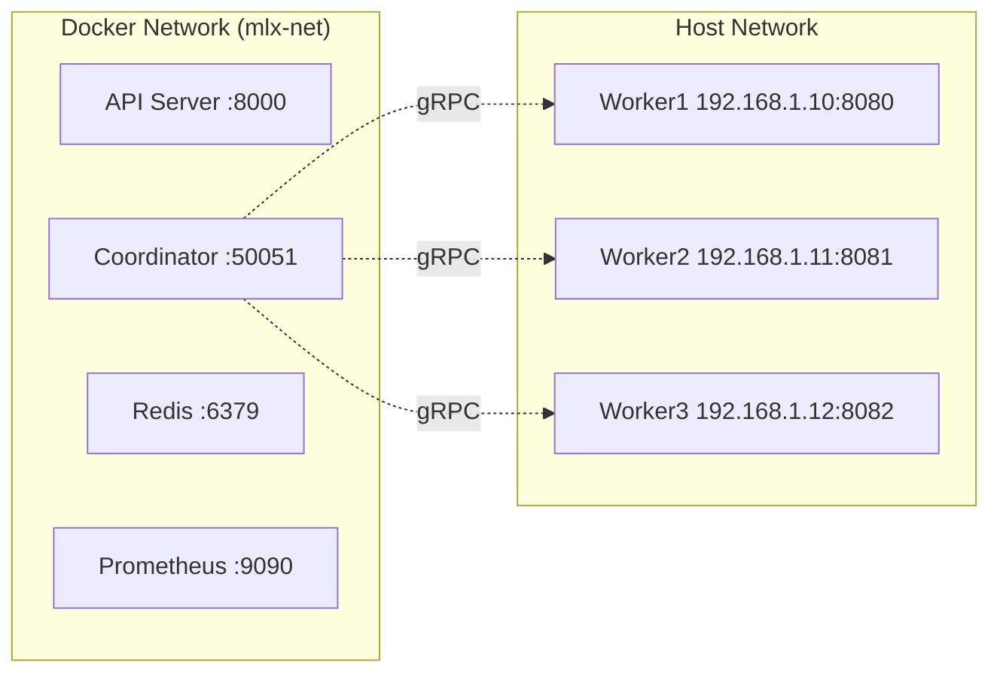

# Design Document

## Overview

The MLX Distributed Inference Server implements a hybrid architecture that combines containerized orchestration services with native MLX workers to deliver production-ready distributed machine learning inference. The system provides an OpenAI-compatible API while maximizing performance through direct Metal GPU access on Apple Silicon hardware.

### Key Design Principles

- **Hybrid Deployment**: Containerized management services for operational simplicity, native workers for maximum performance
- **Intelligent Routing**: Dynamic load balancing based on worker capacity, latency, and reliability metrics
- **Horizontal Scalability**: Linear scaling across multiple Mac machines with automatic service discovery
- **Production Readiness**: Comprehensive monitoring, health checks, and error handling

## Architecture

### High-Level Architecture



### Network Architecture

The system operates across two network layers:

1. **Docker Network (mlx-net)**: Internal communication between containerized services
2. **Host Network**: Communication with native MLX workers running on Mac hosts



## Components and Interfaces

### 1. API Server (Containerized)

**Technology**: FastAPI + Python 3.11
**Deployment**: Docker container
**Responsibilities**:
- OpenAI-compatible REST API endpoints
- Request validation and formatting
- Authentication and rate limiting
- Response streaming support

**Key Interfaces**:
```python
# REST Endpoints
POST /v1/chat/completions
GET /health
GET /metrics
GET /models

# gRPC Client Interface
CoordinatorServiceStub.RouteInference()
CoordinatorServiceStub.StreamInference()
```

**Configuration**:
- Environment-based API key management
- Configurable request timeouts
- Prometheus metrics export
- Distributed tracing integration

### 2. Coordinator Service (Containerized)

**Technology**: Python 3.11 + gRPC
**Deployment**: Docker container
**Responsibilities**:
- Worker pool management and service discovery
- Intelligent request routing and load balancing
- Health monitoring and failure detection
- Metrics aggregation

**Key Interfaces**:
```python
# gRPC Server Interface
RegisterWorker(WorkerRegistration) -> RegistrationResponse
RouteInference(InferenceRequest) -> InferenceResponse
StreamInference(InferenceRequest) -> Stream[StreamChunk]
Heartbeat(HeartbeatRequest) -> HeartbeatResponse
HealthCheck() -> HealthCheckResponse

# gRPC Client Interface (to workers)
InferenceServiceStub.ProcessInference()
InferenceServiceStub.StreamInference()
```

**Worker Selection Algorithm**:
```python
def calculate_worker_score(worker, request):
    load_factor = worker.current_load / worker.max_concurrent
    perf_factor = worker.avg_latency / 1000.0
    reliability_factor = worker.failed_requests / max(worker.total_requests, 1)
    
    return (load_factor * 0.5 + 
            perf_factor * 0.3 + 
            reliability_factor * 0.2)
```

### 3. MLX Worker (Native)

**Technology**: Python 3.11 + MLX + Metal
**Deployment**: Native macOS process
**Responsibilities**:
- Native MLX inference with direct Metal access
- Model loading and memory management
- Token-by-token streaming generation
- Performance metrics collection

**Key Interfaces**:
```python
# gRPC Server Interface
ProcessInference(InferenceRequest) -> InferenceResponse
StreamInference(InferenceRequest) -> Stream[StreamChunk]
HealthCheck() -> HealthStatus
GetMetrics() -> WorkerMetrics

# MLX Integration
mlx_lm.load(model_path) -> (model, tokenizer)
mlx_lm.generate(model, tokenizer, prompt, **params) -> str
mlx_lm.stream_generate(model, tokenizer, prompt, **params) -> Iterator[str]
```

**Device Detection**:
```python
def get_device_info():
    model = subprocess.check_output(['sysctl', '-n', 'hw.model'])
    memory_bytes = int(subprocess.check_output(['sysctl', '-n', 'hw.memsize']))
    memory_gb = memory_bytes / (1024**3)
    gpu_cores = detect_gpu_cores(model)  # Based on chip type
    
    return {
        'model': model,
        'memory_gb': memory_gb,
        'gpu_cores': gpu_cores
    }
```

### 4. Load Balancer (Containerized)

**Technology**: nginx
**Deployment**: Docker container
**Configuration**:
```nginx
upstream api_servers {
    server api:8000;
    # Additional API servers for HA
}

server {
    listen 80;
    location / {
        proxy_pass http://api_servers;
        proxy_set_header Host $host;
        proxy_set_header X-Real-IP $remote_addr;
    }
}
```

### 5. Monitoring Stack (Containerized)

**Components**:
- **Prometheus**: Metrics collection and storage
- **Grafana**: Visualization dashboards
- **Jaeger**: Distributed tracing
- **Redis**: Caching and session storage

## Data Models

### gRPC Protocol Definitions

```protobuf
// inference.proto

service CoordinatorService {
    rpc RegisterWorker(WorkerRegistration) returns (RegistrationResponse);
    rpc RouteInference(InferenceRequest) returns (InferenceResponse);
    rpc StreamInference(InferenceRequest) returns (stream StreamChunk);
    rpc Heartbeat(HeartbeatRequest) returns (HeartbeatResponse);
    rpc HealthCheck(HealthCheckRequest) returns (HealthCheckResponse);
}

service InferenceService {
    rpc ProcessInference(InferenceRequest) returns (InferenceResponse);
    rpc StreamInference(InferenceRequest) returns (stream StreamChunk);
    rpc HealthCheck(Empty) returns (HealthStatus);
    rpc GetMetrics(Empty) returns (WorkerMetrics);
}

message InferenceRequest {
    string request_id = 1;
    string prompt = 2;
    int32 max_tokens = 3;
    float temperature = 4;
    float top_p = 5;
    int32 seed = 6;
    string model = 7;
    bool use_cache = 8;
}

message InferenceResponse {
    string request_id = 1;
    string text = 2;
    repeated int32 tokens = 3;
    int32 prompt_tokens = 4;
    int32 completion_tokens = 5;
    float tokens_per_second = 6;
    string worker_id = 7;
    float latency_ms = 8;
}

message WorkerRegistration {
    string worker_id = 1;
    string address = 2;
    DeviceInfo device_info = 3;
    int32 max_concurrent = 4;
}

message DeviceInfo {
    string model = 1;
    int32 memory_gb = 2;
    int32 gpu_cores = 3;
}
```

### Worker State Management

```python
@dataclass
class WorkerInfo:
    worker_id: str
    address: str
    device_info: Dict
    max_concurrent: int
    current_load: int = 0
    last_heartbeat: float = field(default_factory=time.time)
    status: str = "healthy"  # healthy, unhealthy, draining
    
    # Performance metrics
    avg_latency: float = 0.0
    tokens_per_second: float = 0.0
    total_requests: int = 0
    failed_requests: int = 0
```

## Error Handling

### Error Categories and Responses

1. **Worker Unavailable**
   - HTTP 503 Service Unavailable
   - Automatic retry on different worker
   - Circuit breaker pattern for failed workers

2. **Authentication Errors**
   - HTTP 401 Unauthorized
   - Clear error messages for invalid API keys
   - Rate limiting for failed attempts

3. **Validation Errors**
   - HTTP 400 Bad Request
   - Detailed field-level validation messages
   - OpenAI-compatible error format

4. **Inference Errors**
   - HTTP 500 Internal Server Error
   - Automatic retry with exponential backoff
   - Detailed logging for debugging

### Retry Strategy

```python
async def retry_with_backoff(func, max_retries=3, base_delay=1.0):
    for attempt in range(max_retries):
        try:
            return await func()
        except Exception as e:
            if attempt == max_retries - 1:
                raise
            delay = base_delay * (2 ** attempt)
            await asyncio.sleep(delay)
```

### Circuit Breaker Implementation

```python
class CircuitBreaker:
    def __init__(self, failure_threshold=5, timeout=60):
        self.failure_threshold = failure_threshold
        self.timeout = timeout
        self.failure_count = 0
        self.last_failure_time = None
        self.state = "CLOSED"  # CLOSED, OPEN, HALF_OPEN
    
    async def call(self, func):
        if self.state == "OPEN":
            if time.time() - self.last_failure_time > self.timeout:
                self.state = "HALF_OPEN"
            else:
                raise CircuitBreakerOpenError()
        
        try:
            result = await func()
            if self.state == "HALF_OPEN":
                self.state = "CLOSED"
                self.failure_count = 0
            return result
        except Exception as e:
            self.failure_count += 1
            self.last_failure_time = time.time()
            if self.failure_count >= self.failure_threshold:
                self.state = "OPEN"
            raise
```

## Testing Strategy

### Unit Testing

**API Server Tests**:
- Request validation and formatting
- Authentication and authorization
- Error handling and edge cases
- OpenAI compatibility

**Coordinator Tests**:
- Worker selection algorithms
- Load balancing logic
- Health check mechanisms
- Failure recovery scenarios

**Worker Tests**:
- MLX integration and model loading
- Inference accuracy and performance
- Memory management
- gRPC communication

### Integration Testing

**End-to-End Flows**:
- Complete request lifecycle from API to worker
- Streaming response handling
- Multi-worker load distribution
- Failure scenarios and recovery

**Performance Testing**:
- Latency benchmarks (target: P50 < 100ms + generation time)
- Throughput testing (target: 30-50 tokens/sec per worker)
- Concurrent request handling
- Memory usage under load

### Load Testing

```python
# Example load test scenario
async def load_test_scenario():
    concurrent_requests = 50
    requests_per_second = 10
    duration_seconds = 300
    
    # Simulate realistic chat completion requests
    tasks = []
    for i in range(concurrent_requests):
        task = asyncio.create_task(
            send_chat_completion_request(
                model="mistral-7b",
                messages=[{"role": "user", "content": "Hello, world!"}],
                max_tokens=100
            )
        )
        tasks.append(task)
        
        if i % requests_per_second == 0:
            await asyncio.sleep(1.0)
    
    results = await asyncio.gather(*tasks, return_exceptions=True)
    analyze_performance_metrics(results)
```

### Monitoring and Observability Testing

**Metrics Validation**:
- Prometheus metrics accuracy
- Grafana dashboard functionality
- Alert rule effectiveness

**Tracing Verification**:
- Jaeger trace completeness
- Request correlation across services
- Performance bottleneck identification

## Performance Considerations

### Optimization Strategies

1. **Model Loading Optimization**
   - Lazy loading with caching
   - Model quantization (4-bit, 8-bit)
   - Memory-mapped model files

2. **Request Batching**
   - Dynamic batching for similar requests
   - Batch size optimization based on model and hardware
   - Timeout-based batch flushing

3. **Memory Management**
   - MLX memory pool optimization
   - Garbage collection tuning
   - Memory usage monitoring and alerts

4. **Network Optimization**
   - gRPC connection pooling
   - Message compression
   - Keep-alive configuration

### Scalability Targets

- **Latency**: P50 < 100ms + generation time, P99 < 500ms + generation time
- **Throughput**: 30-50 tokens/sec per worker (7B 4-bit model)
- **Concurrency**: 4-8 concurrent requests per worker
- **Horizontal Scale**: Linear scaling up to 8 workers
- **Availability**: 99.9% uptime with proper health checks

## Security Considerations

### Authentication and Authorization

```python
# API Key validation
def validate_api_key(auth_header: str) -> bool:
    if not auth_header or not auth_header.startswith("Bearer "):
        return False
    
    token = auth_header[7:]
    valid_keys = os.getenv("API_KEYS", "").split(",")
    return token in valid_keys and len(token) >= 32
```

### Network Security

- TLS encryption for external connections (configurable)
- Internal service communication over Docker networks
- Firewall rules for worker registration ports
- Rate limiting and DDoS protection

### Data Privacy

- No persistent storage of inference requests
- Optional request/response logging with PII filtering
- Secure model file access controls
- Memory clearing after inference completion

## Deployment Architecture

### Docker Compose Configuration

```yaml
version: '3.8'
services:
  nginx:
    image: nginx:alpine
    ports: ["80:80"]
    volumes: ["./nginx.conf:/etc/nginx/nginx.conf"]
    depends_on: [api]
    
  api:
    build: ./api
    environment:
      - COORDINATOR_HOST=coordinator:50051
      - ENABLE_AUTH=true
      - API_KEYS=${API_KEYS}
    depends_on: [coordinator, redis]
    
  coordinator:
    build: ./coordinator
    ports: ["50051:50051"]
    depends_on: [redis]
    
  redis:
    image: redis:alpine
    ports: ["6379:6379"]
    
  prometheus:
    image: prom/prometheus
    ports: ["9090:9090"]
    volumes: ["./prometheus.yml:/etc/prometheus/prometheus.yml"]
    
  grafana:
    image: grafana/grafana
    ports: ["3000:3000"]
    environment:
      - GF_SECURITY_ADMIN_PASSWORD=admin
    
  jaeger:
    image: jaegertracing/all-in-one
    ports: ["16686:16686", "14268:14268"]
```

### Worker Deployment

```yaml
# config/worker.yaml
worker_id: "worker-mac-studio-01"
model_path: "/models/mistral-7b-instruct-v0.1"
port: 8080
coordinator_host: "coordinator.local:50051"
max_concurrent: 4
distributed: false

device:
  memory_limit_gb: 32
  gpu_memory_fraction: 0.8
```

## Advanced Memory Management

### Memory Pooling Architecture

The system implements tensor memory pooling to reduce allocation overhead and improve memory efficiency:

```python
class TensorMemoryPool:
    """Global memory pool for tensor reuse."""
    
    def __init__(self, max_pool_size_bytes: int = 2 * 1024**3):
        self.pools: Dict[Tuple[tuple, str], List[PooledTensor]] = {}
        self.max_pool_size = max_pool_size_bytes
        self.stats = MemoryPoolStats()
        
    def allocate(self, shape: tuple, dtype) -> mx.array:
        """Allocate tensor from pool or create new."""
        pool_key = (shape, str(dtype))
        
        # Try to reuse from pool
        if pool_key in self.pools and self.pools[pool_key]:
            tensor = self.pools[pool_key].pop()
            self.stats.cache_hits += 1
            return tensor.array
        
        # Allocate new tensor
        self.stats.cache_misses += 1
        return mx.zeros(shape, dtype=dtype)
    
    def release(self, tensor: mx.array):
        """Return tensor to pool for reuse."""
        pool_key = (tuple(tensor.shape), str(tensor.dtype))
        
        if self.get_total_allocated() < self.max_pool_size:
            pooled = PooledTensor(tensor, pool_key)
            self.pools.setdefault(pool_key, []).append(pooled)
```

**Expected Performance:**
- 80-95% tensor reuse rate
- 20-30% memory overhead reduction
- Automatic cleanup under memory pressure

### Garbage Collection Optimization

The system optimizes Python's garbage collection for inference workloads:

```python
class GCOptimizer:
    """Optimize garbage collection for inference workloads."""
    
    def __init__(self):
        self.gc_threshold = (10000, 20, 20)  # Increased gen 0 threshold
        self.manual_gc_enabled = False
        
    def tune_for_inference(self):
        """Tune GC for inference workload."""
        # Disable automatic GC during inference
        gc.disable()
        self.manual_gc_enabled = True
        
        # Increase generation 0 threshold
        gc.set_threshold(*self.gc_threshold)
        
    def manual_gc_cycle(self):
        """Trigger manual GC between requests."""
        if self.manual_gc_enabled:
            gc.collect(generation=0)
```

**Integration with Inference Engine:**
```python
class InferenceEngine:
    def __init__(self):
        self.gc_optimizer = GCOptimizer()
        self.gc_optimizer.tune_for_inference()
        
    async def process_inference(self, request):
        # Process inference
        result = await self._run_inference(request)
        
        # Manual GC after request
        self.gc_optimizer.manual_gc_cycle()
        
        return result
```

**Expected Performance:**
- 30-50% GC pause reduction
- More predictable latency
- Reduced GC overhead

### Tensor Lifecycle Management

The system tracks tensor lifecycles to enable eager deallocation:

```python
class TensorLifecycleManager:
    """Manage tensor lifecycle for efficient memory usage."""
    
    def __init__(self):
        self.tracked_tensors: Dict[str, PooledTensor] = {}
        self.reference_counts: Dict[str, int] = {}
        
    def track_tensor(self, tensor_id: str, tensor: mx.array):
        """Track tensor for lifecycle management."""
        self.tracked_tensors[tensor_id] = tensor
        self.reference_counts[tensor_id] = 1
        
    def increment_reference(self, tensor_id: str):
        """Increment reference count."""
        if tensor_id in self.reference_counts:
            self.reference_counts[tensor_id] += 1
            
    def release_tensor(self, tensor_id: str):
        """Release tensor when no longer needed."""
        if tensor_id not in self.reference_counts:
            return
            
        self.reference_counts[tensor_id] -= 1
        
        if self.reference_counts[tensor_id] == 0:
            # Eagerly deallocate
            if tensor_id in self.tracked_tensors:
                del self.tracked_tensors[tensor_id]
                mx.metal.clear_cache()
```

**Expected Performance:**
- 15-25% memory reduction
- No memory leaks
- Accurate reference tracking

## Distributed Cache Coherence

### KV Cache Serialization

To support multi-turn conversations in distributed inference, the system serializes and transfers KV cache between pipeline stages:

```python
# In activation_transfer.py
def serialize_kv_cache(self, cache: List[Tuple[mx.array, mx.array]]) -> bytes:
    """Serialize KV cache for transfer."""
    # Serialize each (key, value) pair
    # Add to existing serialization format
    pass

def deserialize_kv_cache(self, data: bytes) -> List[Tuple[mx.array, mx.array]]:
    """Deserialize KV cache from transfer."""
    # Parse cache data
    # Return list of (key, value) tuples
    pass
```

**Protocol Update:**
```protobuf
// In proto/distributed.proto
message ForwardPassRequest {
    // ... existing fields ...
    bytes cache_data = 10;  // Serialized KV cache
}

message ForwardPassResponse {
    // ... existing fields ...
    bytes updated_cache = 10;  // Updated KV cache
}
```

**Integration:**
```python
# In worker/distributed_forward.py (line 420)
async def forward_with_cache(self, request):
    # Serialize cache for request
    if self.cache:
        cache_data = self.activation_transfer.serialize_kv_cache(self.cache)
        request.cache_data = cache_data
    
    # Forward to next stage
    response = await self.forward_distributed(request)
    
    # Deserialize updated cache
    if response.updated_cache:
        self.cache = self.activation_transfer.deserialize_kv_cache(
            response.updated_cache
        )
```

## Memory-Aware Partitioning

For heterogeneous clusters with different memory capacities, the system implements memory-aware layer partitioning:

```python
class ModelPartitioner:
    def _profile_layer_memory(self, model_name: str, layer_idx: int) -> int:
        """Profile memory usage of a single layer."""
        # Load layer
        # Measure memory before/after
        # Return memory delta in bytes
        pass
    
    def _partition_memory_aware(
        self,
        total_layers: int,
        nodes: List[Dict[str, Any]]
    ) -> List[LayerAssignment]:
        """Partition based on available memory."""
        # Get layer memory requirements
        layer_memory = self.profile_model_memory(model_name, total_layers)
        
        # Get available memory per node
        node_memory = [node['available_memory'] for node in nodes]
        
        # Bin packing algorithm
        assignments = []
        current_node = 0
        current_memory = 0
        current_layers = []
        
        for layer_idx, mem_required in enumerate(layer_memory):
            if current_memory + mem_required > node_memory[current_node]:
                # Move to next node
                assignments.append(LayerAssignment(
                    node_id=nodes[current_node]['node_id'],
                    start_layer=current_layers[0],
                    end_layer=current_layers[-1] + 1
                ))
                current_node += 1

                current_memory = 0
                current_layers = []
            
            current_memory += mem_required
            current_layers.append(layer_idx)
        
        return assignments
```

**Comparison with Balanced Partitioning:**
- Balanced: Equal layers per node (may overload low-memory nodes)
- Memory-aware: Distributes based on actual memory capacity
- Use case: Heterogeneous clusters with different Mac models

## Production Deployment Strategy

### Deployment Phases

**Phase 1: Single Node Validation (Day 1)**
- Deploy worker on Mac Studio 1
- Verify model loading and inference
- Test metrics collection
- Validate performance baselines

**Phase 2: Distributed Setup (Days 2-3)**
- Deploy worker on Mac Studio 2
- Configure coordinator and API server
- Test distributed inference pipeline
- Verify activation transfer

**Phase 3: Monitoring Stack (Days 4-5)**
- Deploy Prometheus, Grafana, Jaeger
- Configure dashboards and alerts
- Test metrics collection
- Validate tracing

**Phase 4: Load Testing (Days 6-7)**
- Run sustained load tests (1 hour)
- Run spike tests (10 minutes)
- Run stress tests (30 minutes)
- Run stability tests (24 hours)

**Phase 5: Optimization (Days 8-10)**
- Analyze performance data
- Tune configuration parameters
- Re-run tests to validate improvements
- Document best practices

### Performance Targets

**Latency Targets:**
- P50: < 100ms (excluding generation time)
- P95: < 200ms (excluding generation time)
- P99: < 500ms (excluding generation time)

**Throughput Targets:**
- Per worker: 30-50 tokens/sec (7B 4-bit model)
- Cluster: Linear scaling with worker count
- GPU utilization: 75-95%

**Reliability Targets:**
- Error rate: < 1%
- Uptime: 99.9%
- Cache hit rate: 40-60%
- Batch efficiency: 95%+

### Monitoring and Alerting

**Critical Alerts:**
- Worker unavailable (no heartbeat for 30s)
- High error rate (>5% over 5 minutes)
- High latency (P95 > 500ms for 5 minutes)
- Memory pressure (>90% utilization)
- Low throughput (<20 tokens/sec for 5 minutes)

**Warning Alerts:**
- Moderate error rate (>2% over 5 minutes)
- Elevated latency (P95 > 300ms for 5 minutes)
- Memory pressure (>80% utilization)
- Cache hit rate low (<30%)
- GC pause frequency high (>10/minute)

### Configuration Tuning Guide

**Batch Processing:**
```yaml
batch_manager:
  max_batch_size: 32  # Adjust based on GPU memory
  max_wait_time_ms: 50  # Balance latency vs throughput
  adaptive_sizing: true
  target_gpu_utilization: 0.85
```

**Memory Management:**
```yaml
memory_pool:
  max_pool_size_gb: 8  # Adjust based on available memory
  max_idle_seconds: 600
  enable_auto_cleanup: true

gc_optimizer:
  manual_gc_enabled: true
  gc_threshold: [10000, 20, 20]
```

**Caching:**
```yaml
activation_cache:
  max_size_gb: 4
  ttl_seconds: 3600
  eviction_policy: lru

kv_cache:
  enable_sharing: true
  enable_compression: true
  compression_level: 3
```

**Worker Pool:**
```yaml
coordinator:
  max_concurrent_per_worker: 4
  health_check_interval_seconds: 10
  unhealthy_threshold_seconds: 30
  removal_threshold_seconds: 120
```

This design provides a comprehensive foundation for implementing the MLX distributed inference server with all the architectural components, interfaces, and considerations needed for a production-ready system, including advanced memory management, distributed cache coherence, and production deployment strategies.
